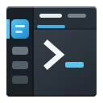
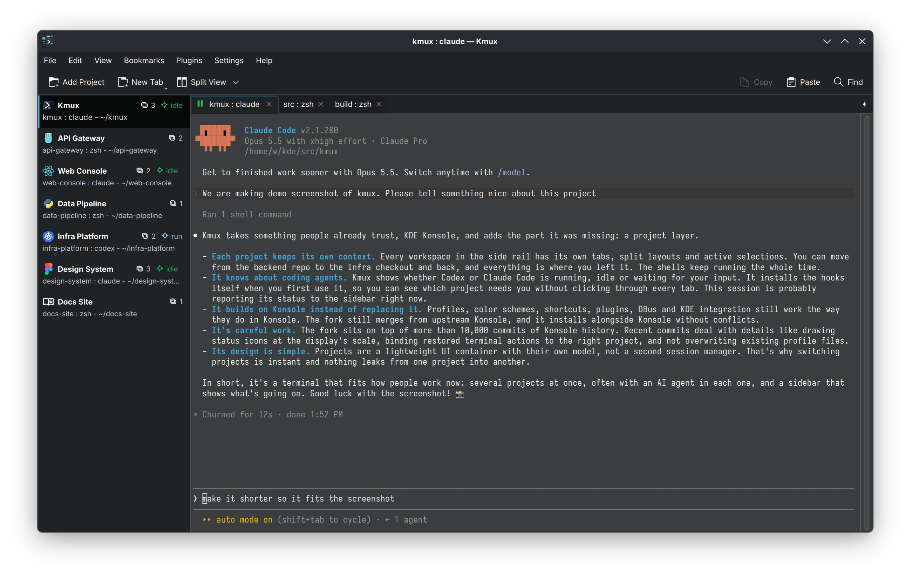

# Kmux

Kmux is a terminal for KDE Plasma that groups your terminals by project. It is
a fork of [Konsole](https://apps.kde.org/konsole/) with a
[cmux](https://cmux.com/)-inspired project rail: every project keeps its own
tabs and split views, and switching projects never stops a running session.



## Features

- a vertical project rail with renaming, drag-and-drop ordering, icons, and
  keyboard navigation;
- independent tabs and split views in every project; tabs can be moved between
  projects;
- activity indicators, notifications, and the statuses of Claude Code, Codex,
  OpenCode, Pi, and other programs (running, needs input, idle, usage limit) on
  projects and tabs;
- restoration of projects, tabs, splits, and working directories after a
  restart;
- everything else from Konsole: profiles, color schemes, shortcuts, search,
  plugins, and KDE integration;
- installs next to Konsole without conflicts.

## Status

Kmux is alpha software, currently 0.1.0-alpha.2. Expect bugs, including ones
that lose the saved workspace. Most notably:

- restoring a workspace starts new shells; it does not bring back the programs
  that were running in them;
- Kmux uses a single main window;
- the format of the saved workspace may change between alpha releases.

The [user guide](doc/user-guide.md#known-limitations) lists all known
limitations.

## Installation

On Arch Linux, install the AUR package
[`kmux-workspaces-git`](https://aur.archlinux.org/packages/kmux-workspaces-git),
which builds the current `master` branch from GitHub. Use an AUR helper, for
example `paru -S kmux-workspaces-git`, or `makepkg`:

```sh
git clone https://aur.archlinux.org/kmux-workspaces-git.git
cd kmux-workspaces-git
makepkg -si
```

A `kmux-workspaces` package that builds release tags will follow the first
release.

On other distributions, build Kmux from source. It needs CMake 3.16, a C++20
compiler, Qt 6.5, KDE Frameworks 6.6, ICU, and, by default, libssh;
[`BUILD.md`](BUILD.md) lists the exact components.

```sh
git clone https://github.com/vityas-off/kmux.git
cd kmux
cmake -B build -DCMAKE_BUILD_TYPE=Release -DCMAKE_INSTALL_PREFIX=/usr
cmake --build build --parallel
sudo cmake --install build
```

Kmux installs next to Konsole. [`BUILD.md`](BUILD.md) also covers build
options, running the tests, and removing a manual installation.

## Getting Started

Add a project with **Add Project** on the toolbar, from the context menu of the
project rail, or with `Ctrl+Alt+P`. Double-click a project to rename it; its
context menu changes the icon or closes it. Tabs and split views work as in
Konsole, and **Move Tab to Project** in a tab's context menu moves it to
another project.

| Shortcut | Action |
| --- | --- |
| `Ctrl+Alt+P` | Add a project |
| `Ctrl+Alt+PgDown` / `Ctrl+Alt+PgUp` | Next / previous project |
| `Ctrl+Alt+1` … `Ctrl+Alt+9` | Switch to project 1–9 |
| `Ctrl+Alt+A` | Next project needing attention |

Kmux leaves `Ctrl+Alt+T` to Konsole; the
[user guide](doc/user-guide.md#global-shortcut) explains how to assign a global
shortcut to Kmux.

Codex, Claude Code, OpenCode 2, and Pi report their status to Kmux themselves,
without any setup. The [user guide](doc/user-guide.md) explains the agent
integration, including a plugin for OpenCode 1, and
what to do after upgrading from an earlier build, what workspace restoration
brings back, and how to reset a broken workspace.

## Alternatives

- [cmux](https://github.com/manaflow-ai/cmux), which inspired Kmux: a
  Ghostty-based terminal with vertical tabs, for macOS only.
- [herdr](https://herdr.dev/): an agent-aware terminal multiplexer for Linux
  and macOS that keeps agents running after you detach.
- [tmux](https://github.com/tmux/tmux) or [Zellij](https://zellij.dev/), if you
  mainly need persistent sessions.

## Support and Contributing

Report bugs in [GitHub Issues](https://github.com/vityas-off/kmux/issues) and
send changes as pull requests. Kmux is not supported by KDE, so please do not
report Kmux problems to KDE unless they also happen in Konsole. Report
security issues privately as described in [`SECURITY.md`](SECURITY.md).

## Acknowledgements and License

Kmux is built on [KDE Konsole](https://invent.kde.org/utilities/konsole) and
keeps its licenses; see [`COPYING`](COPYING), [`COPYING.LIB`](COPYING.LIB), and
[`COPYING.DOC`](COPYING.DOC). Its project model is inspired by cmux. Kmux is an
independent project, not affiliated with KDE or cmux, whose names belong to
their respective owners.
